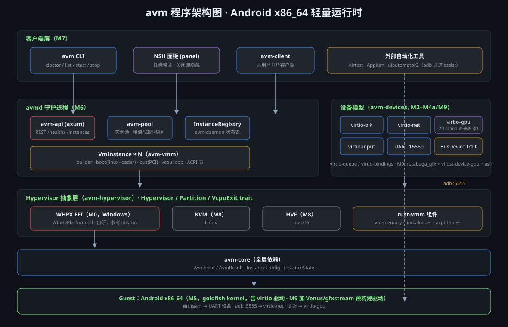

# 程序架构图

层次说明（自上而下）：

1. **客户端层**：avm CLI、NSH 面板、共用 avm-client；外部自动化工具经 adb 通道（assist）直达 guest。
2. **avmd 守护进程**：avm-api(axum) + avm-pool + InstanceRegistry + VmInstance×N（avm-vmm）。
3. **设备模型**：virtio-blk/net/gpu/input、UART，统一 BusDevice trait；M9 由 rutabaga_gfx 提供 3D。
4. **Hypervisor 抽象层**：WHPX FFI（M0）/ KVM（M8）/ HVF（M8）同一 trait；rust-vmm 组件支撑。
5. **avm-core**：全层共享错误与类型。
6. **Guest**：Android x86_64（goldfish kernel）。
